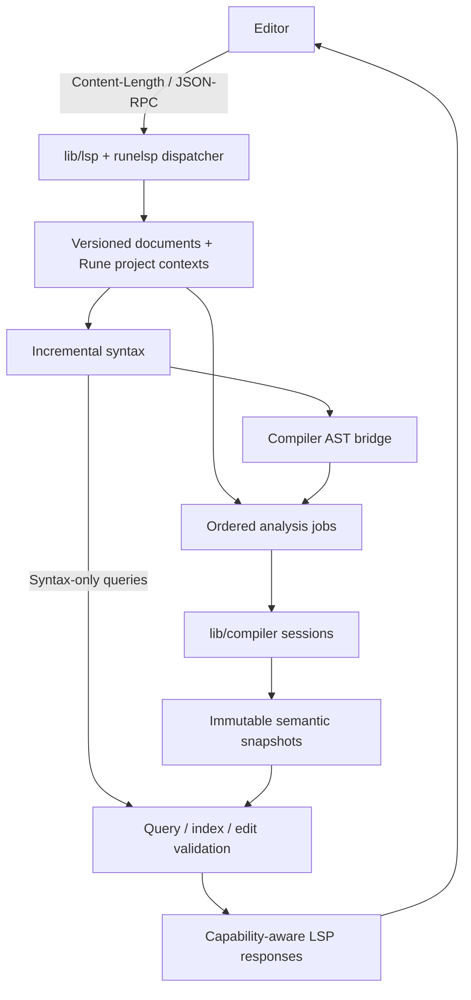

# Roadmap: the Rune language server

`runelsp` gives editors compiler-backed Standard ML editing over the
Language Server Protocol (LSP). Its goal is every feature of LSP 3.18
that has a useful, sound meaning for Rune, including editing incomplete
programs, projects with several files and build contexts, and notebooks.
The compiler remains the authority for scope, fixity, types and modules.

This is a roadmap, dated 2026-10-22. It specifies future work; the
protocol inventory below is not a claim that a server exists. It is
temporary: each implemented milestone puts its user contract in permanent
documentation and its evidence beside the tests before this plan is retired.

## Status

| Milestone | What | Depends on | State |
|---|---|---|---|
| M0 | This roadmap, baseline and protocol inventory | none | done 2026-10-22; verification below; measurements remain M1 |
| M1 | Reference study, fixtures and performance baselines | M0 | in progress: SML harness and Linux baseline recorded; native Windows measurement remains |
| M2 | Protocol libraries, transport, lifecycle and harness | M0 | in progress: protocol foundation and focused Linux checks implemented; final profile/platform acceptance remains |
| M3 | Documents, positions, workspaces and build contexts | M2 | in progress: synchronization, reusable codecs, shared project planning and workspace requests implemented; combined/platform acceptance pending |
| M4 | Incremental syntax, recovery and the parser decision | M1, M3 | in progress: separate SML parser, lossless pieces, lexical/declaration reuse, AST bridge and differential checks implemented; performance/platform acceptance pending |
| M5 | Compiler sessions, semantic snapshots and invalidation | M3, M4; compiler-library M1-M4 and the analysis contract below | in progress: immutable queries, scoped replay, provenance, supervised workers and scheduling/integration implemented; settings/recovery/performance and full acceptance remain |
| M6 | Document and workspace diagnostics | M5 | in progress: push/pull/workspace reports, refresh, cancellation and partial progress implemented; full coverage/performance acceptance remains |
| M7 | Hover, navigation and symbols | M5 | in progress: navigation, document/workspace symbols and stale resolve tests pass; documentation, broader module cases and measurements remain |
| M8 | Completion, signature help and inline completion | M7 | in progress: lexical/qualified/record completion, documentation resolve, invocation snippets, signature help, negotiated inline patterns and build-file path completion implemented; broader recovery and full acceptance remain |
| M9 | Highlighting, hints, structural editing, links and colours | M4, M7 | in progress: document highlights, captured syntax, folding/selection, semantic tokens, inferred pattern hints and compiler-resolved build links implemented; colours, safe linked editing and full acceptance remain |
| M10 | References, rename and workspace/file edits | M5-M7 | planned |
| M11 | Formatting, code actions, refactorings and lenses | M4, M7-M10 | planned |
| M12 | Call hierarchy, monikers and virtual source content | M7, M10 | planned |
| M13 | Notebook synchronization and static cell analysis | M5-M9 | planned |
| M14 | Distribution, interoperability and full acceptance | M1-M13 | planned |

M0 is this document, not a completed implementation experiment. M1-M4 can
progress while the compiler library is being extracted. M5 cannot be
declared done through an adapter that repeatedly calls the current global
driver. The usable preview is after M8 and its prerequisite checks: a
standalone server with project analysis, diagnostics, navigation and
completion. M9-M13 remain required for full acceptance at M14.

Implementation began on 2026-10-22 in the isolated `language-server`
worktree, branched from refreshed `origin/master` at
`c3e713891e6ea9f32770371427fdfa5f76369255`. The M0 checks below describe
the earlier documentation baseline; they are not acceptance results for
this new branch. M1 remeasures the current compiler and records its own
fixture and tool identities.

The owner also explicitly requested the compiler-library refactor as part
of this work on 2026-10-22. This branch therefore owns the prerequisites
in [compiler-library.md](compiler-library.md), including extraction,
exports, session isolation, the public API and client migration; it will
not leave M5 waiting for an unspecified external implementation.

## The request and the decisions

The original draft asks for a language server named `runelsp`, all useful
LSP 3.18 features, compiler reuse, a parser optimized for incremental
latency, and generic reusable functionality in `lib`. A single parser is
allowed only if prototyping and benchmarks show less than 10% performance
loss in each role. Reference checkouts are under
`/home/ruud/reference-lsp`; the protocol's [server catalogue][servers] and
[langserver.org][langserver] are discovery aids.

The owner's choices while expanding the draft are:

| Decision | Chosen |
|---|---|
| D1. Product and clients | Standalone `runelsp` first. Rune IDE migration is a separate roadmap. Keep the analysis interface usable by another SML client. |
| D2. Coverage | The full applicable LSP 3.18 set. Each method has a disposition below; missing implementations are planned, not silently excluded. |
| D3. Compiler reuse | The compiler-library session API is a prerequisite for resident semantic analysis. Extend it with the required analysis operations rather than build another elaborator. |
| D4. Parser | A separate incremental parser in SML by default; share a parser only after the strict performance and correctness gate below. Tree-sitter is a research reference, not a required runtime dependency. |
| D5. State | One mutable compiler session at a time in a worker; published semantic snapshots are immutable data. Workspaces and contexts cannot share mutable elaborator state. |
| D6. Project meaning | Rune's build language and compiler determine order, visibility, dependencies, library and source-mode settings. Ambiguous contexts require an explicit selection. |
| D7. Notebook meaning | SML code cells are checked in visible document order. Execution history, values and kernel state are outside this static model. |
| D8. Transport and distribution | Portable stdio first, using Content-Length framing; diagnostics and logs never share stdout with protocol data. Install beside Rune with a relocatable library wrapper. |
| D9. Reusable code | Reuse and improve `lib/json`, `lib/jsonrpc`, `lib/unicode`, `lib/pretty` and `lib/markdown`; put reusable LSP types and codecs in `lib/lsp`. |
| D10. Source edits | Return validated, versioned edits for the client to apply. Static analysis does not execute the project or write source files. |
| D11. Compatibility | Negotiate capabilities and position encodings. An older client receives supported representations; there is no global switch that assumes all of 3.18. |
| D12. Evidence | Fresh compiler analysis is the semantic oracle. Record measurements and limitations; no latency or memory result is asserted by this document. |

Generic requirements such as JSON-RPC or an eventual XML reader belong in
tested libraries. LSP itself needs JSON, not XML; this roadmap does not add
an XML library without a consumer. Language rules stay in SML and outside
editor adapters. A VS Code extension, if supplied, launches and configures
the server and contributes file associations only.

## Where it starts

The baseline inspected for this document is Rune commit
`78192dfd91e494f5864fcedf7fcc3a163d1ab0e7`. This identifies the source
inspection, not a new performance or full-suite result. Recheck this table
when M1 starts; source locations may move with the compiler-library work.

| Existing component | What is available | What runelsp still needs |
|---|---|---|
| [Compiler architecture](../architecture.md), `src/frontend`, `src/elab` | Lexer, recursive-descent parser, scoped fixity, annotated AST, stamped binders, type and module checking | Tolerant incremental syntax and a stable, read-only semantic projection for editor queries |
| `src/util/source.sml` | Byte spans, source registry, modes and unsaved overlays; Latin-1 disk text is decoded to UTF-8, overlays are already decoded | Versioned multi-document ownership, incremental line indexes and negotiated LSP coordinates |
| `src/util/error.sml`, `diagnostic.sml` | Collected diagnostics and JSON export alongside terminal rendering | Stable codes, structured related information and safe edits where the compiler can substantiate them; no parsing of rendered error strings |
| `src/driver/unitbasis.sml`, `unitcache.sml`, `pipeline.sml` | Ordered unit analysis, bases, fixity state, dependency usages and content-addressed cache machinery | Snapshot-aware checking, immutable query data and tested replay across unsaved edits |
| `src/driver/buildfile.sml`, `deps.sml` | Rune build-file semantics and dependency discovery | Overlay-aware project discovery, context selection and build-file editor features |
| `src/driver/serve.sml` | Prototype diagnostics and hover through a newline JSON-RPC protocol, with a forked child per request | LSP transport, lifecycle, capabilities, simultaneous overlays, scheduling and complete feature handlers |
| `src/repl/engine.sml`, `complete.sml`, `doc.sml` | Checking, type queries, completion and documentation in a REPL session | Reusable static queries against an arbitrary project snapshot; the LSP must not evaluate declarations to answer them |
| [Compiler-library roadmap](compiler-library.md) | A proposed reusable session API; M1-M5 are marked planned in the inspected document | The library and reset/isolation guarantees, plus the analysis additions specified here |
| `lib/basis/compiler.sml` | A structure already named `RuneCompiler` containing REPL hooks and pretty-printer controls | This is not the proposed reusable compiler session API; settle names and exports in compiler-library work |
| `lib/json`, `lib/jsonrpc` | Strict JSON, JSON-RPC values, line and Content-Length framing, cancellation message helpers | LSP-specific validation, bounded framing, request tracking, capability/state machines and typed codecs |
| `lib/unicode`, `lib/pretty`, `lib/markdown`; runedoc | Unicode operations, document layout, Markdown and compiler-backed documentation extraction | Coordinate indexing, source formatting and signature-aware documentation lookup |
| [Jupyter kernel](../kernel.md), [DAP adapter](../dap.md) | Notebook execution and debugging as separate protocols | LSP notebook synchronization and static analysis, without assuming a running kernel |

`Framing.feed` currently accumulates strings and takes the first length
header it finds. M2 must examine duplicate lengths, resource limits and
fragmentation costs rather than assume the existence of Content-Length
support establishes LSP conformance. `JsonRpc.decode` supports JSON-RPC
batches, but LSP does not: its adapter must refuse batch messages without
removing a facility used by other library clients. Protocol integers must
also cover LSP's specified range on a 31-bit SML host; the current `int`
request-id representation is an item for M2's portability audit.

Rune IDE has useful precedents for ordered overlays, analysis generations,
binding-based navigation and source-coordinate conversion. They are
reference implementations, not proof that their services or this server
are complete. Neither an IDE UI test nor an IDE migration blocks M0-M14.

## What transfers from reference implementations

These are source/design observations from the local checkouts, not
comparative performance measurements. The revision links make the study
reproducible after those checkouts move.

| Reference and inspected revision | Observation | Use in Rune |
|---|---|---|
| [rust-analyzer syntax and architecture][ra], `bcd39e699382e52b7d8c138a934533cc29be0781` | Lossless immutable syntax, error nodes, syntax separated from semantics, and an analysis facade over derived facts | Keep trivia and incomplete syntax; publish immutable views; isolate syntax machinery from LSP. Its older syntax design notes are explanatory, not a current benchmark. |
| [Tree-sitter editing][ts], `e3d578032dec2e7042291864302714878315dbed` | Apply an edit to old ranges, then reuse unchanged subtrees; scanner and parser state constrain reuse | Prototype bounded relexing and structural sharing. A text-identical subtree is not reusable if incoming SML lexical or fixity context changed. |
| [OCaml-LSP][ocaml], `33835879e864a8076f95d832b49c0211adfa229c` | Compiler/Merlin reuse, syntax recovery, build-system integration, and an explicit distinction between unsaved analysis and saved build diagnostics | Reuse elaboration, recover locally, and label diagnostics by their actual snapshot. Do not depend on a background build to understand unsaved Rune sources. |
| [gopls architecture][gopls], `b65ac2ee22000e2f9929e539355d84d651833ed1` | Separate protocol types, coordinate mapper, build views, snapshots, overlays and semantic indexes | Model a file in a build context; keep disk I/O and protocol mapping outside semantic queries. |
| [ZLS document store][zls], `bbd60390ffc1c12cd1aa91688fd2940b22966ee9` | Source handles are associated with build configurations; build results can become invalid while work is in progress | Version build metadata and reject obsolete publications as well as obsolete file analysis. |
| [clangd scheduler][clangd], `ee73fb814cafaf9ae33359f42e10ca849f86f159` | Explicit scheduling of file snapshots, diagnostics and reusable preamble work, with bounded caches | Separate foreground queries from background indexing; preserve useful completed work without publishing stale diagnostics. |

M1 follows these findings into implementation and tests, and compares at
least the SML parser alternatives. It does not assume Rust's scope rules,
Go's package order or C++ preambles apply to Standard ML. In SML an earlier
fixity declaration changes parsing, and a function-body change can change
the inferred type exported to later declarations.

## Architecture

### Boundaries and required interfaces

`lib/lsp` owns protocol data, codecs, error constants, capability helpers
and generic request bookkeeping. It depends on generic libraries, not on
Rune ASTs, the filesystem, compiler types or project policy. Keep
unknown JSON extension fields where required and distinguish an absent
field from an explicit `null`. A metamodel-driven generator/checker in
SML should keep protocol coverage and codecs in agreement with the pinned
specification; generated outputs have one documented regeneration command.

The server executable lives under `src/lsp` with a `runelsp.build` entry
point. The document/syntax and analysis interfaces are SML interfaces that
do not mention LSP JSON. Generic text and persistent-tree machinery goes
in `lib` if it has a reusable interface; Rune grammar and fixity logic
remain compiler/tooling code. Do not move the entire compiler inside the
LSP implementation.

The compiler-library roadmap owns extraction, session creation, reset and
unit APIs. M5 adds or obtains the following capabilities through that
library; the tentative signature in its roadmap alone is insufficient:

* Check an ordered source snapshot with supplied overlays, per-unit
  incoming basis/fixity and source modes, stopping after static analysis.
* Take and restore a valid analysis checkpoint, or replay from an earlier
  checkpoint, without retaining mutations from failed/cancelled analysis.
* Return structured diagnostics, parsed/elaborated source mappings,
  binding/type/module identities and visible environments as data.
* Query visible names, inferred types and definition relationships without
  invoking `run`, loading user dynamic modules or evaluating `use`.
* Poll cancellation at bounded analysis boundaries. An isolated worker can
  be terminated and rebuilt from validated state when a phase cannot yet
  be interrupted safely.

These are required capabilities, not claims about currently exported
function names. Coordinate their public signatures with the library's
tests and permanent API documentation. A fresh isolated compiler check
remains the oracle, not the resident server's own cached answer.

### Documents, positions and paths

A document store owns URI, language, monotonically increasing client
version, decoded text, line/encoding index and syntax revision. Changes
in one notification are applied in order to the successive intermediate
texts, as LSP specifies. Full replacements are accepted alongside ranged
changes. A malformed change must never partially update the stored text;
retain the last valid version, log the synchronization problem and wait
for a valid replacement/reopen rather than pretend that an unstandardized
resynchronization request exists.

Internal spans are half-open byte ranges in the decoded compiler text.
Negotiate UTF-8, UTF-16 or UTF-32 positions, preferring UTF-8 when offered
and falling back to mandatory UTF-16 when negotiation is absent. Index
line starts and character boundaries incrementally. LSP character counts
are code units, not graphemes, display cells or tab-expanded columns.
Follow the specification's end-of-line clamping rule; reject negative
positions and invalid split-character edit boundaries without corruption.
Handle LF, CRLF, CR, empty files, EOF and BOMs explicitly in the mapping.

Keep source mode separate from wire encoding. The compiler's ASCII,
Unicode UTF-8 and Unicode Latin-1 modes control language and literal
semantics; JSON text and editor overlays are decoded Unicode. A Latin-1
overlay is not transcoded a second time. Build-source byte offsets map
through the decoded source, including unsaved mode changes. If a literal
or character is unrepresentable in its configured source mode, report a
diagnostic rather than changing the mode behind the user's back.

Use one URI/path implementation for percent encoding, drive letters, UNC
paths and native path identity. Keep the client URI for replies and a
separate native file key for loading; avoid lowercasing all paths or
collapsing distinct open documents through symlinks. Resolve aliases for
project membership deliberately and detect conflicting overlays. Native
Windows conversion follows the runtime's Unicode/WTF-8 boundary rules;
if a native name cannot be represented by a client URI, give an explicit
limitation instead of lossy substitution. Unknown URI schemes are not
interpreted as local filesystem paths. Untitled documents and registered
read-only virtual documents have document-store identities of their own.

### Workspaces and build contexts

Use the compiler's build-file parser and resolver, extended to read
overlays. Preserve `files` order, `group` dependency analysis, `local`,
exports, renamings, `use`, `implements`, path variables, annotations,
library selection and source modes as [build.md](../build.md) defines
them. An unsaved build-file change invalidates the affected context before
later semantic results can be published.

The configuration section is `runelsp`. It supplies explicit project
roots/build-file URIs, path variables and per-document active project
selection; initialization options provide the same startup configuration
when the client cannot answer `workspace/configuration`. Live workspace
configuration overrides initialization defaults. Build annotations still
have the language-defined precedence over compiler settings. No second
project-file format duplicates `.build` semantics.

Without explicit projects, inspect `.build` files in each workspace root
and ancestors of open documents up to that root; follow their `use`
edges, without recursive filesystem-wide scanning. Resolve enough build
metadata to establish membership. A loose file gets an isolated
single-file context with the configured Basis and source mode. It does
not implicitly concatenate every SML file in its directory.

A context is identified by build root, selected implementation/path
configuration, toolchain/library identity and settings. One source can
have several contexts; semantic caches are keyed by context as well as
source. If explicit selection exists, use it; if exactly one candidate
exists, select it. With several candidates, keep syntax features available
and report the choices through a one-time message/configuration request.
Do not choose a context by filesystem enumeration order. Workspace symbol
search covers all configured contexts and labels/deduplicates results;
position-based queries and diagnostics use the active context. Rename
must check all affected known contexts and refuse incompatible edits.

File watching uses client registration where supported. Otherwise check
content identities before analysis/query reuse and use a bounded polling
fallback for closed dependencies. A rename/create/delete notification
invalidates both membership and semantic indexes. Build-file editing gets
syntax diagnostics, keyword/path completion, links, symbols, formatting
and file-operation edits; SML-only requests return no result there unless
the corresponding concept exists. Document selectors distinguish the two.

### Analysis, scheduling and caches

An analysis snapshot identifies its context/configuration generation,
ordered source identities and overlay versions. Each typed document view
also identifies the syntax revision it describes. Freeze query results,
types and occurrence information before exposing them: a reference into
the elaborator's mutable AST/type variables is not an immutable snapshot.
One worker mutates one compiler session at a time. Multiple contexts are
serialized through a reset/replay boundary or use separate workers;
apparent session handles are not evidence that globals are isolated.

Start invalidation at the earliest changed lexical/fixity/basis input.
Reuse later units only when their actual incoming dependencies still
hold. Preserve generative type identities, signature abstraction,
functor applications, exception identity and overload/defaulting state.
Do not apply rust-analyzer's function-body cut-off rule to inferred SML
exports without proving that the exported basis is unchanged.

Checkpoint only committed valid analysis state. Error recovery may retain
independently checked declarations with their real visibility, but an
unresolved/error value cannot masquerade as a successful binding. A later
declaration that depends on a failed one gets unavailable semantic data or
its own justified diagnostic. Syntax-only features remain available, and
semantic edits require sufficiently complete analysis of all affected
bindings.

Foreground work has priority over background indexing, with work coalesced
by context and obsolete queued diagnostics discarded. The protocol reader
continues to receive edits, server-request responses and cancellations
while checking runs: use the existing portable process/IPC layer if a
cooperative SML scheduler cannot bound the reader's latency. Do not require
SML threads or Unix-only `fork` for correctness. M1/M5 measure worker and
cancellation costs on Windows as well as Linux.

A client request is evaluated against its captured synchronized state.
An ordinary subsequent edit does not by itself require cancelling every
in-flight query: follow LSP's stale-request rules. Always answer a request,
including cancellation, once. Suppress obsolete diagnostic publications;
reject stale resolve/edit objects when their required context is no longer
valid, using the specified error (`ContentModified`, `RequestCancelled` or
`ServerCancelled` where the method permits) rather than a fabricated empty
success. Responses and edit objects carry opaque snapshot data where the
protocol permits it. Never reinterpret an old position in new text.

Keep syntax and unsaved semantic caches in memory first, with bounded
retention. Reuse the frozen Basis and validated on-disk unit cache only
when source, compiler, library, mode, fixity and build-context keys match.
Unsaved text must not be published into the ordinary build cache under a
saved file's identity. Any optional persistent LSP index is separately
versioned, written atomically, and discarded on incompatible schema or
provenance. Rebuilding it must reproduce a fresh result.

### Binding identities and edits

An occurrence points to a binding in its compilation context, not merely
a name or an integer stamp from another process. Within a snapshot retain
the elaborator's binder identity; across cached units translate through
unit identities and compiler-provided name maps. Stable external monikers
add package/library provenance and exported paths. Local stamps and
source line numbers alone are not persistent identifiers.

Track value, constructor, exception, type constructor, type variable,
record label, structure, signature and functor namespaces with their
actual language rules. Navigation through transparent/opaque ascription,
aliases and functor copies must preserve the relationship exposed by the
signature. Implementation queries report statically established
signature/structure or virtual-module implementation relationships, not
unrelated structures that happen to match a signature.

Rename first resolves identity and scope, then checks capture and every
affected build context. Handle `op`, symbolic names and fixity directives,
qualified paths, recursive function clauses and record shorthand. For
example, renaming the bound value in `{x}` may require `{x = renamed}` to
preserve the label. Do not rename arbitrary matching labels or change
operator grouping by substituting text. Decline edits to read-only Basis,
generated or externally owned sources when they cannot be applied safely.

Return non-overlapping, deterministic edits with document versions and
resource operations only when supported. Verify changed syntax and
binding relationships using fresh analysis before returning semantic
refactorings. Compiler-provided fixes use diagnostic identities/codes,
not matches on English message text. A command applies an edit through
the client or returns one; it does not silently rewrite project files.

## Incremental syntax and the parser gate

M4 keeps comments, whitespace, exact token text and error/missing nodes in
a lossless concrete tree. Concatenating leaves reproduces even malformed
input. The tree supports cheap snapshots and changed-region discovery;
types and compiler mutable annotations are not stored in shared nodes.
Compare a persistent tree with reusable subtrees against a simpler
checkpoint/reparse design before committing to a generic tree library.

Incremental lexing needs entry/exit state for nested comments, strings,
string gaps, escapes and Unicode/source-mode handling. Relex until both
token content and outgoing lexical state agree. A small edit that opens
an unclosed comment may legitimately invalidate the rest of a file; the
server still needs cancellation and a bounded response path.

SML fixity is an explicit parsing input and output. Reuse the compiler's
fixity resolution rules; represent unresolved application/operator
sequences where that allows structural parsing before resolution. An
earlier `infix`, `infixr` or `nonfix` edit can invalidate later expression
and pattern resolution, nested `local` scopes and subsequent files even
where their text is unchanged. The AST bridge must match compiler parsing
for all complete supported programs, including derived forms and Rune
extensions. A recovered node is not a new accepted language feature.

### What is compared

Compare (A) the existing batch parser plus a dedicated incremental parser,
(B) a shared parser with separate batch/incremental entry modes, and (C)
bounded declaration/subtree reparsing if it differs materially from A.
Tree-sitter is a design/control comparison where a suitable SML grammar is
available; writing a C binding or importing an incomplete grammar is not
a prerequisite for comparing the SML designs. Record licensing/provenance
before reusing any reference source.

Use the same language coverage, sources, compiler build, machine and
normalised output. Batch timing includes lexing, parsing and the required
AST construction/bridge; interactive timing includes edit application,
relexing, repair/reuse and the representation needed by immediate queries.
Report those phases separately as well as their sum, so work cannot be
shifted out of the timed path. Measure allocations and peak/retained
memory beside time, and cold full parses beside warm edit traces.

Use paired runs with interleaved candidates, a fixed warm-up, at least 20
independent repetitions of each trace and enough edits to estimate p99.
Publish raw samples, commands, hardware, runtime/JIT/GC settings, fixture
hashes and candidate revisions. Rerun noisy or statistically inconclusive
comparisons; report confidence intervals rather than rounding 10.1% away.

Let `B` be total batch time of the dedicated batch implementation and
`I95`/`I99` the dedicated incremental implementation's edit latency
percentiles on the same trace. Sharing is allowed only when correctness
passes and the upper confidence bound of each shared/dedicated time ratio
is strictly below `1.10`: batch, incremental p95 and incremental p99, on
each representative fixture class. Report p50 too. Equality at 1.10,
an inconclusive result or a large-file regression fails the gate. Retain
separate parsers in that case and share token definitions, fixity logic,
AST lowering or test fixtures where this passes the same correctness
contract. No production parser is replaced merely because a prototype
works on a small file.

## LSP 3.18 coverage

The inventory was checked against the [official 3.18.0 metamodel][meta]
downloaded on 2026-10-22, SHA-256
`ce9e95e3c2a1ef333f5b7d64be7c8d31138af736a3d128cd5d99165e9dd26a5d`:
**69 requests and 26 notifications**. M2 vendors a reviewed copy/schema
identity for reproducible generation and adds an inventory check. A newer
upstream metamodel requires a deliberate diff of methods and properties.
The prose [specification][lsp] decides behavior where metadata alone is
insufficient.

In the tables `C>S` means client to server, `S>C` server to client, `R`
request and `N` notification. **P** means required, planned implementation;
**N/A** means an explicit exclusion, whose capability remains absent.
Every P is still gated by the relevant client capabilities. Capability
names in these tables identify the governing feature; the rules in the
next section include optional sub-capabilities and response fallbacks.
Tests are acceptance groups defined under *Testing*: every table entry
must map to a transcript or semantic fixture, including exclusions.

### Lifecycle, transport, window and configuration

| Method | Direction | Plan | Capability / negotiation | Rune behavior and acceptance |
|---|---|---|---|---|
| `initialize` | C>S R | P M2 | client capabilities; server capabilities | Negotiate once; return server identity, encodings and only implemented providers. P0 |
| `initialized` | C>S N | P M2 | lifecycle | Begin permitted registrations/background work after initialization. P0 |
| `shutdown` | C>S R | P M2 | lifecycle | Reply null, stop accepting ordinary work, wait for exit. P0 |
| `exit` | C>S N | P M2 | lifecycle | Exit with the specified status depending on shutdown; clean up workers. P0 |
| `client/registerCapability` | S>C R | P M2 | each feature's dynamicRegistration | Register negotiated selectors/watchers with stable IDs; handle refusal. P1 |
| `client/unregisterCapability` | S>C R | P M2 | corresponding registration | Remove registrations when settings/workspaces change; balance IDs. P1 |
| `$/cancelRequest` | both N | P M2 | request IDs | Cancel matching pending work, retain a single final response. P0 |
| `$/progress` | both N | P M2 | request progress tokens | Track work and partial-result tokens without mixing request IDs. P1 |
| `window/workDoneProgress/create` | S>C R | P M2 | window.workDoneProgress | Create server-initiated progress only with client support. P1 |
| `window/workDoneProgress/cancel` | C>S N | P M2 | created progress token | Cancel the associated job and end progress. P1 |
| `$/setTrace` | C>S N | P M2 | trace setting | Change trace verbosity without restarting. P1 |
| `$/logTrace` | S>C N | P M2 | current trace setting | Emit bounded trace data only at requested verbosity. P1 |
| `window/showMessage` | S>C N | P M2 | window message conventions | Actionable startup/configuration messages; no per-keystroke popups. P1 |
| `window/showMessageRequest` | S>C R | P M3 | window.showMessage | Offer context choices; handle dismissal and unsupported UI. W0 |
| `window/logMessage` | S>C N | P M2 | MessageType support | Operational messages, with stderr as the local log. P1 |
| `window/showDocument` | S>C R | P M7 | window.showDocument.support | Open a selected source/documentation target; handle failure. Q0 |
| `telemetry/event` | S>C N | N/A M14 | none advertised | No product telemetry consumer or analytics requirement; do not send it. P1 |
| `workspace/configuration` | S>C R | P M3 | workspace.configuration | Fetch scoped runelsp settings; retain startup defaults when unavailable. W0 |
| `workspace/didChangeConfiguration` | C>S N | P M3 | workspace.didChangeConfiguration | Re-read scoped settings and invalidate affected contexts. W0 |
| `workspace/workspaceFolders` | S>C R | P M3 | workspace.workspaceFolders | Discover initial folders when available. W0 |
| `workspace/didChangeWorkspaceFolders` | C>S N | P M3 | workspace.workspaceFolders.changeNotifications | Add/remove roots, jobs, registrations and diagnostics. W0 |
| `workspace/didChangeWatchedFiles` | C>S N | P M3 | workspace.didChangeWatchedFiles; relativePatternSupport | Invalidate changed closed sources, build files and library metadata. W0 |

### Text and notebook synchronization

| Method | Direction | Plan | Capability / negotiation | Rune behavior and acceptance |
|---|---|---|---|---|
| `textDocument/didOpen` | C>S N | P M3 | textDocumentSync.openClose | Overlay owns text until close; disk cannot overwrite it. D0 |
| `textDocument/didChange` | C>S N | P M3 | textDocumentSync.change = Incremental | Apply ranged/full changes in order; reject broken transitions atomically. D0 |
| `textDocument/didClose` | C>S N | P M3 | textDocumentSync.openClose | Release overlay, revert to disk identity, invalidate dependants. D0 |
| `textDocument/didSave` | C>S N | P M3 | textDocumentSync.save | Reconcile saved identity without replacing a newer overlay. D0 |
| `textDocument/willSave` | C>S N | P M3 | textDocumentSync.willSave | Track save state; do not block or execute a build. D0 |
| `textDocument/willSaveWaitUntil` | C>S R | P M11 | textDocumentSync.willSaveWaitUntil | Optional configured formatting/trailing-space edits within a save deadline; otherwise empty edits. E1 |
| `notebookDocument/didOpen` | C>S N | P M13 | notebookDocumentSync.notebookSelector | Open SML cells with shared document identities and ordered context. N0 |
| `notebookDocument/didChange` | C>S N | P M13 | notebookDocumentSync | Apply structure, cell text, language and metadata changes exactly once. N0 |
| `notebookDocument/didSave` | C>S N | P M13 | notebookDocumentSync.save | Update saved notebook metadata; no cell execution. N0 |
| `notebookDocument/didClose` | C>S N | P M13 | notebookDocumentSync | Release notebook ownership and dependent cell analysis. N0 |

### Diagnostics, navigation and symbols

| Method | Direction | Plan | Capability / negotiation | Rune behavior and acceptance |
|---|---|---|---|---|
| `textDocument/publishDiagnostics` | S>C N | P M6 | textDocument.publishDiagnostics | Push current diagnostics for clients not using pull; clear removed results. A0 |
| `textDocument/diagnostic` | C>S R | P M6 | diagnosticProvider; textDocument.diagnostic | Full/unchanged reports with result IDs and related documents. A0 |
| `workspace/diagnostic` | C>S R | P M6 | diagnosticProvider.workspaceDiagnostics; workspace.diagnostics | Versioned reports for configured project contexts; partial results/cancellation. A0 |
| `workspace/diagnostic/refresh` | S>C R | P M6 | workspace.diagnostics.refreshSupport | Request a repull after relevant non-document context changes. A0 |
| `textDocument/hover` | C>S R | P M7 | hoverProvider; textDocument.hover | Resolved type, signature-aware docs and exact source range. Q0 |
| `textDocument/declaration` | C>S R | P M7 | declarationProvider; textDocument.declaration | Interface/specification site where known, otherwise the binding's declaration. Q0 |
| `textDocument/definition` | C>S R | P M7 | definitionProvider; textDocument.definition | Actual binder definition through aliases and qualified paths. Q0 |
| `textDocument/typeDefinition` | C>S R | P M7 | typeDefinitionProvider; textDocument.typeDefinition | Visible type constructor declaration; preserve abstraction. Q0 |
| `textDocument/implementation` | C>S R | P M7 | implementationProvider; textDocument.implementation | Proven signature and virtual-module implementations within indexed contexts. Q0 |
| `textDocument/documentSymbol` | C>S R | P M7 | documentSymbolProvider; textDocument.documentSymbol | Nested SML declarations and build-file sections; hierarchical/flat fallback. Q0 |
| `workspace/symbol` | C>S R | P M7 | workspaceSymbolProvider; workspace.symbol | Cancellable indexed search across configured contexts. Q0 |
| `workspaceSymbol/resolve` | C>S R | P M7 | workspaceSymbolProvider.resolveProvider; workspace.symbol.resolveSupport | Resolve deferred location data for the same indexed identity. Q0 |
| `textDocument/references` | C>S R | P M10 | referencesProvider; textDocument.references | Binding-based occurrences, including requested declarations. E0 |
| `textDocument/prepareCallHierarchy` | C>S R | P M12 | callHierarchyProvider; textDocument.callHierarchy | Prepare a resolved callable item with snapshot data. H0 |
| `callHierarchy/incomingCalls` | C>S R | P M12 | negotiated call hierarchy | Incoming statically resolved call sites; no invented dynamic targets. H0 |
| `callHierarchy/outgoingCalls` | C>S R | P M12 | negotiated call hierarchy | Outgoing statically resolved calls, preserving source sites. H0 |
| `textDocument/moniker` | C>S R | P M12 | monikerProvider; textDocument.moniker | Stable provenance-qualified exported symbols; snapshot-local identity otherwise. H0 |
| `textDocument/prepareTypeHierarchy` | C>S R | N/A M14 | typeHierarchyProvider absent | SML has no subtype/supertype hierarchy; type aliases and signature matching are not inheritance. H0 |
| `typeHierarchy/supertypes` | C>S R | N/A M14 | typeHierarchyProvider absent | No fabricated hierarchy; unsupported-request behavior tested. H0 |
| `typeHierarchy/subtypes` | C>S R | N/A M14 | typeHierarchyProvider absent | Same exclusion; use type/implementation navigation for actual SML relationships. H0 |

### Completion and presentation

| Method | Direction | Plan | Capability / negotiation | Rune behavior and acceptance |
|---|---|---|---|---|
| `textDocument/completion` | C>S R | P M8 | completionProvider; textDocument.completion | Scope/type/module-aware candidates, keywords and build paths. Q1 |
| `completionItem/resolve` | C>S R | P M8 | completionProvider.resolveProvider; completionItem.resolveSupport | Resolve only advertised lazy fields against valid item data. Q1 |
| `textDocument/signatureHelp` | C>S R | P M8 | signatureHelpProvider; textDocument.signatureHelp | Curried, tuple, infix and partial-application parameters. Q1 |
| `textDocument/inlineCompletion` | C>S R | P M8 | inlineCompletionProvider; textDocument.inlineCompletion | Deterministic syntactic/typed templates; no remote model dependency. Q1 |
| `textDocument/semanticTokens/full` | C>S R | P M9 | semanticTokensProvider; textDocument.semanticTokens | Negotiated legend, real binding kinds and modifiers. Q2 |
| `textDocument/semanticTokens/full/delta` | C>S R | P M9 | semanticTokensProvider.full.delta; requests.full.delta | Deltas only from matching retained result IDs; otherwise a full result. Q2 |
| `textDocument/semanticTokens/range` | C>S R | P M9 | semanticTokensProvider.range; requests.range | Whole intersecting tokens in the negotiated encoding. Q2 |
| `workspace/semanticTokens/refresh` | S>C R | P M9 | workspace.semanticTokens.refreshSupport | Refresh when dependencies/configuration change classifications. Q2 |
| `textDocument/documentHighlight` | C>S R | P M9 | documentHighlightProvider; textDocument.documentHighlight | Current-document occurrences by identity, with justified read/write kinds. Q2 |
| `textDocument/inlayHint` | C>S R | P M9 | inlayHintProvider; textDocument.inlayHint | Inferred type/parameter hints with positions and bounded density. Q2 |
| `inlayHint/resolve` | C>S R | P M9 | inlayHintProvider.resolveProvider; inlayHint.resolveSupport | Lazy tooltip/location/edits only when supported and still valid. Q2 |
| `workspace/inlayHint/refresh` | S>C R | P M9 | workspace.inlayHint.refreshSupport | Refresh dependency-sensitive hints. Q2 |
| `textDocument/foldingRange` | C>S R | P M9 | foldingRangeProvider; textDocument.foldingRange | Comments, declarations and blocks, respecting client line/range limits. Q2 |
| `workspace/foldingRange/refresh` | S>C R | P M9 | workspace.foldingRange.refreshSupport | 3.18 refresh after relevant non-document changes. Q2 |
| `textDocument/selectionRange` | C>S R | P M9 | selectionRangeProvider; textDocument.selectionRange | Nested syntax selections, including incomplete input. Q2 |
| `textDocument/linkedEditingRange` | C>S R | P M9 | linkedEditingRangeProvider; textDocument.linkedEditingRange | Repeated names within one recursive function's clauses where identical replacement preserves binding and syntax; not cross-scope rename. Q2 |
| `textDocument/documentLink` | C>S R | P M9 | documentLinkProvider; textDocument.documentLink | Build paths and statically known documentation/source links. Q2 |
| `documentLink/resolve` | C>S R | P M9 | documentLinkProvider.resolveProvider | Resolve deferred targets without executing path expressions. Q2 |
| `textDocument/documentColor` | C>S R | P M9 | colorProvider; textDocument.colorProvider | Statically resolved terminal Style.Rgb applications with literal channels in 0..255. Q2 |
| `textDocument/colorPresentation` | C>S R | P M9 | colorProvider; textDocument.colorProvider | Return equivalent Style.Rgb source edits; do not guess colours in arbitrary strings or change alpha semantics. Q2 |
| `textDocument/inlineValue` | C>S R | N/A M14 | inlineValueProvider absent | Requires debugger stopped-frame/runtime context; belongs to separate DAP/runtime integration. Q2 |
| `workspace/inlineValue/refresh` | S>C R | N/A M14 | no inline-value registration | No runtime inline-value producer in a static server. Q2 |

### Edits, actions, resources and virtual documents

| Method | Direction | Plan | Capability / negotiation | Rune behavior and acceptance |
|---|---|---|---|---|
| `textDocument/prepareRename` | C>S R | P M10 | renameProvider.prepareProvider; rename.prepareSupport | Check editable identity, range and valid rename domain. E0 |
| `textDocument/rename` | C>S R | P M10 | renameProvider; textDocument.rename | Capture-safe edits validated across affected contexts. E0 |
| `workspace/applyEdit` | S>C R | P M10 | workspace.applyEdit; workspace.workspaceEdit | Apply user-requested edits through client and handle refusal/failure. E0 |
| `workspace/willCreateFiles` | C>S R | P M10 | workspace.fileOperations.willCreate | Propose applicable build-membership edits, never infer order by filename alone. W1 |
| `workspace/didCreateFiles` | C>S N | P M10 | workspace.fileOperations.didCreate | Refresh project membership after actual creation. W1 |
| `workspace/willRenameFiles` | C>S R | P M10 | workspace.fileOperations.willRename | Update statically resolved build paths/links with versioned edits. W1 |
| `workspace/didRenameFiles` | C>S N | P M10 | workspace.fileOperations.didRename | Reconcile identities, overlays and index entries after actual rename. W1 |
| `workspace/willDeleteFiles` | C>S R | P M10 | workspace.fileOperations.willDelete | Propose deterministic removal of explicit build references or report unsafe ambiguity. W1 |
| `workspace/didDeleteFiles` | C>S N | P M10 | workspace.fileOperations.didDelete | Drop removed sources and publish current missing-dependency diagnostics. W1 |
| `textDocument/formatting` | C>S R | P M11 | documentFormattingProvider; textDocument.formatting | Stable source formatter over lossless syntax. E1 |
| `textDocument/rangeFormatting` | C>S R | P M11 | documentRangeFormattingProvider; textDocument.rangeFormatting | Format a safe containing syntax region, document expanded bounds. E1 |
| `textDocument/rangesFormatting` | C>S R | P M11 | documentRangeFormattingProvider.rangesSupport; rangeFormatting.rangesSupport | 3.18 multi-range formatting with merged regions and non-overlapping edits. E1 |
| `textDocument/onTypeFormatting` | C>S R | P M11 | documentOnTypeFormattingProvider; textDocument.onTypeFormatting | Bounded local indentation on advertised triggers; preserve malformed surrounding text. E1 |
| `textDocument/codeAction` | C>S R | P M11 | codeActionProvider; textDocument.codeAction | Diagnostic fixes, explicit source actions and validated SML refactorings. E1 |
| `codeAction/resolve` | C>S R | P M11 | codeActionProvider.resolveProvider; codeAction.resolveSupport | Compute advertised lazy edits only for valid snapshot data. E1 |
| `textDocument/codeLens` | C>S R | P M11 | codeLensProvider; textDocument.codeLens | Static reference/implementation counts with navigation commands. E1 |
| `codeLens/resolve` | C>S R | P M11 | codeLensProvider.resolveProvider; codeLens.resolveSupport | Resolve supported properties against indexed binding identity. E1 |
| `workspace/codeLens/refresh` | S>C R | P M11 | workspace.codeLens.refreshSupport | Refresh counts after dependent edits. E1 |
| `workspace/executeCommand` | C>S R | P M11 | executeCommandProvider; workspace.executeCommand | Namespaced advertised edit/navigation commands with validated arguments. E1 |
| `workspace/textDocumentContent` | C>S R | P M12 | workspace.textDocumentContent | 3.18 immutable virtual source/signature views for known schemes. H0 |
| `workspace/textDocumentContent/refresh` | S>C R | P M12 | negotiated textDocumentContent provider | Refresh changed virtual content; retain old identity only while valid. H0 |

### Cross-cutting capability and property coverage

Method coverage alone does not establish 3.18 conformance. M2 maintains a
property inventory from the metamodel: supported, decoded/ignored where
permitted, or excluded with a reason. Do not advertise a boolean provider
while silently missing its required operations. Negotiate at least:

* Static versus dynamic registration, document/notebook selectors and 3.18
  relative-pattern filters; workspace folders, file-operation filters,
  watcher relative patterns, cancellation and partial/work progress.
* UTF-8/16/32 positions; hierarchical symbols, symbol kinds/tags,
  `LocationLink`, Markdown/plaintext markup and supported diagnostic tags,
  codes, code descriptions, related information and version support.
* Completion snippets and plain text, insert/replace ranges, label
  details, commit characters, insert-text modes, lazy properties, list
  defaults and 3.18 `completionList.applyKind`. Never emit list defaults
  or merge rules the client did not advertise.
* Signature label offsets, trigger/retrigger context, active signatures
  and curried parameters. An explicit null active parameter requires 3.18
  `noActiveParameterSupport`; older clients receive a legal fallback.
* Diagnostic result IDs and workspace refresh; 3.18 diagnostic
  `MarkupContent` messages only with `markupMessageSupport`, otherwise
  ordinary strings. Negotiate diagnostic tags independently of message
  markup. Semantic-token legend,
  supported types/modifiers, overlapping/multiline support, full/range/
  delta requests and allowed cancellation behavior; hint refresh/resolve.
* Versioned `documentChanges`, resource operations, failure handling,
  change annotations and supported 3.18 workspace-edit metadata and
  snippet edits. Expand snippets to ordinary text if unsupported, and
  decline an operation when its essential resource semantics cannot be
  represented. Do not silently omit part of a rename.
* Action literal kinds, preferred/disabled actions, resolve properties,
  3.18 action-kind documentation and action-tag support. Rune's
  deterministic actions do not carry the `LLMGenerated` tag; decoding a
  client's tag capability does not require inventing generated actions.
  Command tooltips, code-lens resolvable properties and the 3.18 debug
  message kind have compatible unadorned/log fallbacks.

Use one diagnostic delivery model per document/context: pull when the
client negotiates it, push otherwise. Honour workspace pull separately;
do not display duplicate push/pull problems. For methods excluded above,
omit the capability, send no corresponding refresh, and use the specified
unsupported-request behavior if a client nevertheless requests them.
Unknown optional fields do not turn a compatible client into an error.

## Milestones

Size estimates are relative, not dates or measured line counts: S is a
bounded component, M spans several interfaces, L needs a subsystem, XL
crosses compiler/project/protocol boundaries. Each milestone is a
reviewable change or series of commits with its own acceptance evidence.
Keep this status table current; record actual limitations instead of
moving a required feature into an unnamed backlog.

### M0. The roadmap (S)

* **Depends on:** none.
* **Deliver:** verified baseline, chosen decisions, reference revisions,
  95-method inventory, dependency order and permanent-doc destinations.
* **Check:** reconcile every original draft requirement and every method
  in the pinned metamodel; verify local links and dependency acyclicity;
  run the repository's documentation checks.
* **Done when:** the document passes those checks and records their actual
  outcomes. No parser, server or performance experiment is marked built.

#### M0 verification (2026-10-22)

Source baseline: `78192dfd91e494f5864fcedf7fcc3a163d1ab0e7`.

* Inventory audit: all 69 requests and 26 notifications in the pinned
  metamodel appear exactly once, with matching directions/message kinds,
  milestone dispositions and acceptance groups.
* Document audit: original draft requirements retained, M0-M14 dependency
  graph acyclic, local links/reference labels valid, Markdown tables and
  fences balanced, and no whitespace errors. All ten public reference
  URLs, including the six pinned source revisions, returned HTTP 200.
* `make check-docs JOBS=8`: passed, including generated-library freshness,
  comment lint, claims and notes checks.
* `make test-doc JOBS=8`: passed all 27 tests. The local result ledger is
  `tests/out/r/20261022-012508-84/summary.md`.
* `make check JOBS=8`: `PASS 17250 of 17250 tests (2 SKIP, 17248 PASS)`;
  1608.7 seconds for the test tier after prerequisite builds. It ran
  outside the restricted sandbox for process/socket integration coverage.
  The skips are `lang/native/rt.interrupt_self` and
  `lang/native-cycles/rt.interrupt_self`: native code does not poll for the
  user's interrupt, as documented in `docs/native.md`. The local ledger is
  `tests/out/r/20261022-013224-1699072/summary.md`.

These are M0 documentation/baseline checks. M1-M14 remain planned; no
language-server feature, parser prototype or latency target was validated
by editing this document.

### M1. References, fixtures and baselines (M)

* **Depends on:** M0.
* **Deliver:** follow the reference-study observations into source/tests;
  a reproducible SML benchmark/trace runner and fixed fixtures covering
  tiny files, the compiler/Basis, large files and a multi-file corpus such
  as HOL4. Pin external corpus revisions/licences and distinguish programs
  Rune accepts from malformed/edit-only fixtures.
* **Check:** cold/warm batch lex/parse/check times, isolated versus
  resident startup, disk/frozen-Basis cache costs, edit application and
  line-index costs, query p50/p95/p99, allocations and retained/peak
  memory. Include opening/editing/closing cycles and cancellation load.
* **Done when:** rerunning recorded commands reproduces classified
  results, the independent oracle catches planted stale-state/fixity
  faults, and a baseline ledger sets fixture-specific release budgets.
  Parser sharing already has the stricter fixed gate above. Other initial
  latency targets remain labelled proposals until this measurement.

#### M1, implemented so far (2026-10-22)

`make lsp-bench` builds the SML measurement program from
`tools/lsp/bench.build`; `make test-lsp-bench` runs arithmetic/fault oracles
and independent command-level acceptance. [The fixture and command
contract](../../tests/lsp/README.md) documents strict result-directory
ownership, fixture verdicts, source identities, separate timed phases,
warmup exclusion, retention passes and prototype-service measurements.

The [initial ledger](../../tests/lsp/baseline/2026-10-22-initial.json)
records 700 frontend/edit phase samples, 20 independent prototype startup
and query runs, raw-artifact hashes, source hashes and proposed budgets.
The machine was an Intel Xeon E5-1680 v3 at 3.20 GHz under WSL2, with 16
available processors. The Linux run used 20 repetitions, three warmups
and three separate retention cycles. The raw measurements and observer
binaries are archived under
`rune-benchmark-results/lsp/2026-10-22-language-server-m1`.

| Existing newline service, microseconds | p50 | p95 | p99 |
|---|---|---|---|
| Process startup and initialize | 32415 | 45889 | 49826 |
| First diagnostics in a private unit cache | 31871 | 58698 | 59438 |
| Repeated diagnostics | 24395 | 43749 | 50108 |
| Repeated hover | 30963 | 44580 | 51358 |

The prototype starts a fresh child for each analysis request; these are
not resident runelsp query results. Its self-hosted entry implements
`--serve`, while current native-host entries call the batch driver.
Private cache/process runs do not flush the operating-system disk cache.
After three separately collected fixture replays, live data was 439344,
439320 and 439296 bytes: this small observed run is not the future
100-cycle project-retention acceptance test.

The current lexer already has `Lexer.scan`, a tolerant line scanner with
comment/gap state used for presentation. M4 should reuse that knowledge
and `lexerOf`'s token rules where appropriate; neither is a complete
incremental syntax tree or a replacement for the parser-sharing gate.

Validated here: fixture classification, ordered fixity, the independently
interpreted stale-fixity fault, edit/undo replay, sample/warmup counts,
prototype diagnostics/hover, refusal to overwrite evidence, and refusal
to publish successful timing summaries after planted verdict/service
failures. Native Windows measurements and unavailable future query/
cancellation paths remain unrecorded. M2 can proceed independently while
those platform measurements are completed.

### M2. Protocol and harness (L)

* **Depends on:** M0.
* **Deliver:** `lib/lsp`, reviewed metamodel import/checker, executable
  skeleton and a SML transcript client using independently reviewed wire
  expectations. Reuse JSON-RPC while adding bounded header/body parsing,
  LSP integer/ID validation, single-message restriction, outstanding
  server/client requests and lifecycle/capability state machines.
* **Check:** P0/P1; every-byte fragmentation, several messages per read,
  multibyte body lengths, duplicate/malformed lengths, unsupported
  charset, oversized input, numeric/string IDs, out-of-order responses,
  unexpected EOF, unknown methods, notification errors, cancellation
  races, request/response errors and shutdown/exit statuses.
* **Done when:** minimal/modern-client transcripts pass, no log reaches
  protocol stdout, malformed input cannot leave unbounded retained data,
  and the generic libraries pass their host suites including 31-bit
  integer boundary probes. Library changes include signature docs and
  generated library documentation as the repository requires.

#### M2, implemented so far (2026-10-22)

`lib/lsp` supplies portable wire integers, positions/ranges, envelopes,
capability negotiation and bounded request ownership. The generated
inventory has 95 methods, 814 declared wire properties and 250 enum
members; its source, hash and CC BY 4.0 attribution are preserved in
`tools/lsp/protocol`. Generation and a planted stale-output rejection are
tested by `make test-lsp-protocol` and `make check-lsp-protocol`.

`make lsp` builds `bin/runelsp`. Independent transcripts validate its
stdio lifecycle, full-width ids, encoding negotiation, initialization
progress, tracing, malformed notification/response handling, bounds and
interactive reads without EOF. It advertises no editing providers yet.
The [permanent user manual](../language-server.md) and
[wire contract](../lsp-protocol.md) describe the implemented behavior.

Shared changes include `Json.intInf`/`toIntInf`, exact JSON-RPC ids/error
codes and a persistent bounded framing reader. The
[paired framing ledger](../../tests/lsp/baseline/2026-10-22-framing.json)
records the original/candidate payload oracle, timings and allocations.
Repository adapters were updated for the new id type. Clean-worktree
protocol-test targets now depend explicitly on their migrated helper;
the new LSP acceptance targets are registered in the normal check tier.

Focused validation passed: five portable LSP groups, independent wire
transcripts, baseline-producer/fault checks, generated inventory/fault
checks, all 11 documentation-consistency tests, REPL protocol (13), DAP
(7) and kernel (9). The protocol integrations were run serially after a
concurrent invocation exposed the runner's shared history-tempfile race.

The six-host library run exposed an obsolete MLKit JSON-RPC deviation, an
intermittent SML/NJ 2026.2 shrink failure, and a new MLKit LSP capability
lookup failure. The first was removed, the second classified HOST-FLAKY,
and the third recorded HOST-BUG after the identical suite passed the
diagnostic `-no_ri` build. Default library/compiler flags remain unchanged.
Fresh classified host/profile acceptance and native Windows acceptance
remain pending; failed exploratory invocations are not counted as passes.

### M3. Documents and projects (L)

* **Depends on:** M2.
* **Deliver:** versioned overlays and line/encoding maps, URI/native-path
  handling, build contexts, scoped configuration, workspace/file watching,
  loose-file mode and explicit ambiguous-context selection. Extend shared
  build-file reading to overlays without duplicating its semantics.
* **Check:** D0/W0; multi-edit notifications, edits around CRLF/BOM/emoji,
  Latin-1 disk versus overlay, untitled files, save/close races,
  rename/delete/watcher races, path variables, nested/local builds,
  virtual implementations, two roots and one file in incompatible builds.
* **Done when:** compiler and server resolve the same saved build inputs,
  unsaved build edits select the corresponding new context, and malformed
  transitions preserve the last valid document state. Record text/index
  update latency and memory from M1 traces.

M3 implementation checkpoint (2026-10-22):

* `lib/lsp` provides strict UTF-8/16/32 position conversion, bounded sparse
  indexes and POSIX/Windows URI conversion, including WTF-8 filename bytes.
  Atomic sequential document changes preserve the preceding valid snapshot
  on failure and quarantine malformed transitions until replacement/reopen.
  Independent token-list edit oracles exercise 1,500 randomized edits.
* `RuneCompiler.Project` and the CLI share scoped build planning, source
  order, group discovery, library headers and inherited annotations.
  Discovery reads captured overlays without executing declarations. The
  server supports multiple roots, scoped settings, explicit ambiguous
  context choices, configuration requests and balanced watcher registration.
* Focused native-host acceptance passed 28 cases at
  `tests/out/r/20261022-152747-3086877` (342.0 seconds), covering all six
  hosts for both codecs and the public compiler API, compiler layout and
  host adaptation. `make test-lsp docs check-docs` passed; documentation
  consistency recorded 11 passes at `tests/out/r/20261022-153216-3089215`.
  Interpreter/JIT workspace checks also pass after the scoped-choice and
  watcher validation follow-up.
* The [document-index ledger](../../tests/lsp/baseline/2026-10-22-documents.json)
  records observer/source hashes and 20 paired edit samples per fixture.
  On this Linux WSL2 host, the 100 KB ASCII multiline fixture measured
  885 microseconds p95 for incremental index updates and 49,910 for fresh
  indexes. A 1 MiB single line measured 15,472 and 434,826 respectively.
  These include text replacement, not parsing or semantic analysis.

M3 remains in progress pending combined acceptance, the full source-mode
and file-operation race matrix, and native Windows evidence. These results
do not establish resident semantic reuse or parser correctness.

### M4. Incremental syntax and recovery (XL)

* **Depends on:** M1, M3.
* **Deliver:** lossless syntax, bounded relexing/reparsing, explicit fixity
  dependencies, error recovery and compiler-AST bridge; prototypes and
  the recorded shared/separate-parser decision. Reuse compiler token and
  fixity definitions where doing so preserves both performance contracts.
* **Check:** S0/S1; accepted/rejected corpus probes, every supported Rune
  syntax form, generated edit/undo sequences, nested comments/string
  gaps, early-file fixity changes and incomplete declarations. Compare
  AST structure after deterministic normalization, diagnostics and
  compiler acceptance; pretty-printed AST text alone is insufficient.
* **Done when:** clean parses agree with the compiler and incremental
  trees equal fresh full trees after every trace step; malformed input
  preserves bytes and later recoverable syntax. Publish paired timings
  and keep parsers separate unless the strict less-than-10% gate passes.

M4 initial implementation checkpoint (2026-10-22):

* `RuneCompiler.Syntax` exposes immutable syntax snapshots and fixity
  environments. Its separate SML recursive-descent parser starts from
  the batch grammar at `3760da885`; the batch parser remains unchanged.
  Complete token boundaries allow suffix reuse across nested comments and
  string gaps. Declaration caches cover top level, structures and local
  scopes, and validate token lookahead and incoming fixities before reuse.
  Changed fixities from earlier files invalidate affected cached parses.
* Lossless pieces cover every source byte, including malformed lexemes.
  Recovery retains later declarations where a lexical scope can be
  established, without treating unterminated comment contents as code.
  Unmatched openers can conservatively consume through EOF. The compiler
  bridge copies every annotation slot, including functor bodies. Published
  syntax events contain no elaborator refs.
* Differential tests compare constructor tags, scalar fields, list lengths
  and spans, rather than the debugging AST printer. The 328 language
  fixtures run in ASCII and Unicode modes, five frontend/parser sources
  and systematic deletion probes match the batch parser's acceptance or
  rejection. Public tests perform 400 randomized edits; the private suite
  also checks 500 edit/undo pairs for full structure, diagnostics,
  topdec boundaries, lossless pieces and outgoing fixities. These suites
  pass in the interpreter and JIT.
* The focused native-host run recorded 12 passes and one sandbox SIGSYS
  (`smlnj32`, exit 159) at `tests/out/r/20261022-160428-202`. The unrestricted
  32-bit retry passed all seven selected runner cases at
  `tests/out/r/20261022-160856-3106277` (25.8 seconds); all six native
  compiler hosts pass the four public syntax tests. Compiler ownership
  tests still pass with 206 roots, byte agreement and restoration checks.
  `make test-lsp docs check-docs` passes; documentation consistency recorded
  11 passes at `tests/out/r/20261022-161023-392` (8.1 seconds).
* The [initial syntax ledger](../../tests/lsp/baseline/2026-10-22-syntax-initial.json)
  archives 300 measurements with lexing, owner setup and required AST
  conversion included. Full editor parsing and EOF edits on the larger
  fixtures exceed batch timings and the proposed local-syntax budget.
  **Keep the parsers separate:** the less-than-10% sharing gate has not
  passed. These initial EOF edits do not establish representative edit-trace
  performance, confidence intervals, memory-retention or Windows acceptance.

M4 remains in progress. Required follow-ups include bounded lexical
checkpoints within long constructs, broader recovery/locality evidence,
representative edit traces and resource/platform acceptance. The existing
compiler lexer is a shared lexical kernel; the editor parser is separate.

Encoding follow-up (2026-10-22): editor lexing now applies the batch
parser's BOM rule to Latin-1 overlays, and the shared lexer rejects raw
overlay characters above U+00FF in that mode. ASCII escapes for wider
literals remain valid. The differential corpus now checks 329 language
fixtures in ASCII, Unicode and decoded Latin-1 modes. Interpreter/JIT
syntax checks and documentation checks pass. The new escaped-character
fixture passed all 82 selected compiler, VM, sanitizer, Windows and
portability cases at `tests/out/r/20261022-174957-3683526` (20.0 seconds).
Earlier exploratory runs exposed restricted 32-bit/LeakSanitizer execution
and unbuilt VM prerequisites; those runs are not counted as passes.

### M5. Compiler-backed semantic snapshots (XL)

* **Depends on:** M3, M4; compiler-library M1-M4 plus the required analysis
  operations and their public tests. Its client migration M5 need not
  block protocol/parser work.
* **Deliver:** typecheck-only session adapter, immutable semantic views,
  checkpoint/replay, unit identity translation, cancellation, worker
  supervision, foreground scheduling and sound dependency cut-off.
* **Check:** A0/S1; compare against fresh isolated analysis after edits to
  earlier files, signatures, functors, exceptions, overloads, source modes
  and build settings. Alternate projects repeatedly; cancel during each
  phase; restart workers; poison cache/context keys in test fixtures.
* **Done when:** no project/session contamination or stale publication is
  observed, binding/type relationships agree with fresh checking, and
  error/cancel recovery does not commit partial compiler mutations.
  Measure analysis, replay, worker startup and cancellation separately;
  retain exact cold-path fallback when reuse is unproven.

M5 foundation checkpoint (2026-10-22):

* [The public analysis API](../compiler-analysis.md) checks captured ordered
  inputs, validates project ownership/group text and returns frozen inputs,
  type facts, constructor identities and lexical source relationships.
  Valid unchanged prefixes replay bases in a fresh owner; rejected units
  expose only their validated prefix. Checkpoints retain unit entries,
  rather than claiming to roll back mutable type cells.
* Provenance distinguishes exception aliases from runtime exception stamps,
  preserves signature declaration/implementation relationships and retains
  a functor body's lexical owner across applications. The version-7 basis
  carries this data through replay. CLI and analysis share scope visibility.
* Six public analysis cases pass in the interpreter and JIT, including
  comparison with fresh batch queries. All 20 selected native-host/API,
  compiler-layout and host-adapter runner cases passed at
  `tests/out/r/20261022-182602-3732836` (500.8 seconds). Ownership/audit
  checks pass with 212 registered roots; documentation checks passed 11
  cases at `tests/out/r/20261022-182347-298` (8.7 seconds).
* Private worker framing and nonblocking pipes reuse the portable
  `Subprocess` layer. Binary bytes, independent input readiness, process
  cancellation and truncated frames pass Linux and native Windows probes.
  These test the transport; the server's semantic job scheduler and
  provider integration remain pending.

M5 remains in progress. Compiler setting coverage, recovery within rejected
units, worker scheduling, stale-publication checks, measurements and final
combined/platform acceptance still need evidence. Editing providers remain
unadvertised.

Resumed integration checkpoint (2026-10-23): the production server now
uses supervised analysis jobs with foreground priority, background
coalescing, cooperative cancellation and process-group termination. The
public lexical query replays frozen inputs, preserves scope at whitespace
and unfinished expressions, and remains usable after closing its context.
Nine public analysis cases cover interpreter/JIT behavior, including
queries after the captured library and manifest have been deleted. These
results do not replace M5's remaining setting/recovery/performance gates.

Protocol-error follow-up (2026-10-23): typed worker rejections preserve
`InvalidParams` and `ContentModified`; one fresh retry recovers an evicted
normal query without accepting stale resolved items. All seventeen
production semantic transcripts pass on Linux and native Windows
(`/tmp/rune-lsp-typed-errors-protocol-tests.log`,
`/tmp/rune-lsp-typed-errors-windows.log`). Worker/scheduler tests, including
typed rejection and startup failure, pass in
`/tmp/rune-lsp-typed-errors-worker-tests.log`.

### M6. Diagnostics (M)

* **Depends on:** M5.
* **Deliver:** push/pull diagnostics, full/unchanged result IDs, related
  documents, workspace reports and refresh. Carry structured severity,
  codes and related locations only where supplied or justified by the
  compiler. Add missing compiler data rather than scrape rendered text.
* **Check:** A0; syntax/type/module errors, warnings, error disappearance,
  dependency-only changes, closed/deleted files, active-context changes,
  stale versions, result-ID eviction, mixed push/workspace-pull clients,
  progress and cancellation during a workspace report. Exercise plain
  versus negotiated markup diagnostic messages.
* **Done when:** every displayed problem identifies the right synchronized
  source/context, old problems clear, pull/push do not duplicate and
  diagnostic content agrees with the fresh compiler. Record edit-to-
  diagnostic latency including queue and serialization time.

### M7. Navigation and symbols (L)

M6/M7 integration evidence (2026-10-23): eleven production stdio transcripts
pass on Linux and native Windows, including push/pull diagnostics,
request/progress cancellation, refresh, stale requests, markup negotiation, native project
paths, closed-source/disk-change workspace diagnostics, partial progress,
navigation, document symbols, workspace symbol resolution and lexical
completion. Logs are `/tmp/rune-lsp-resumed-checkpoint-final.log` and
`/tmp/rune-lsp-completion-windows-final.log`. Compiler ownership/audit checks
pass with 213 registered roots. Documentation consistency passes 11 cases
(`20261023-065129-253`), and public compiler API acceptance passes six runner
cases (`20261023-065452-1420598`). The current full repository result
remains the earlier committed checkpoint (19,392 PASS, three SKIP); these
new changes still require combined acceptance. Initial exploratory runs
with an incorrectly located standalone payload failed worker startup and
are not counted as passing evidence.

* **Depends on:** M5.
* **Deliver:** hover/types/docs; declaration, definition, type and
  implementation navigation; nested document symbols; indexed workspace
  symbols and lazy resolution. Reuse runedoc/REPL documentation extraction
  without leaking internal names through opaque signatures.
* **Check:** Q0; shadowing, `open`, aliases, signature inclusion/ascription,
  datatype and exception replication, functor instantiations, type
  variables, qualified names, read-only Basis and build-file symbols.
* **Done when:** targets name the actual exposed binding, symbol searches
  are deterministic/context-labelled and cancelled/stale resolves cannot
  navigate to an unrelated declaration. Measure warm/cold queries and
  index construction independently.

### M8. Completion and signature help (L)

* **Depends on:** M7.
* **Deliver:** context-appropriate keywords, scoped values/types/modules,
  qualified members, record fields, build paths, documentation resolve
  and typed snippet templates. Initial inline completions offer bounded
  continuations such as a resolved constructor pattern or case skeleton;
  use ordinary completion when inline completion is not negotiated.
* **Check:** Q1; incomplete paths/records/patterns, symbolic `op` names,
  inferred types, hidden signature members, curried/tuple/infix calls,
  partial application, Unicode ranges, trigger/retrigger, old-client
  snippets/defaults and 3.18 apply-kind/null-parameter cases.
* **Done when:** candidates are visible and replacement ranges valid;
  deterministic snippets reparse and, where claimed complete, typecheck.
  Old resolved items fail safely after invalidation. Publish query and
  edit-to-result distributions under concurrent background analysis.

The preview acceptance runs M2-M8 together with at least one real client
on Linux and Windows. Only their implemented providers are advertised.
It remains a preview until the remaining applicable protocol coverage is
accepted at M14.

### M9. Presentation and structural features (L)

The first M9 checkpoint provides binding-based document highlights, including
shadowing, qualified components, prefix/infix clause heads, negotiated position
encodings and an explicit oversized-response refusal. Twenty-two semantic
transcripts pass on Linux and native Windows. Repeated-source probes select
the second occurrence through the real context-choice exchange and check its
inferred type across identical and aliased paths. The adapter obtains opaque
unit identities from `Analysis.unitAt`; the ten public analysis cases also pass
on both Windows widths. The focused cohort and eleven documentation checks
pass in `/tmp/rune-lsp-m9-final-cohort.log` and
`/tmp/rune-lsp-m9-final-doc-check.log`. Native receipts are
`/tmp/rune-lsp-m9-final-highlights-windows.log` and
`/tmp/rune-lsp-m9-final-analysis-windows{64,32}.log`.
Other M9 providers, real-client coverage and performance acceptance remain.

The captured-syntax and structural checkpoint adds folding/refresh and nested
selection, with current recovery trees after parse/type errors. Eleven public
snapshot cases pass on the interpreter/JIT and both Windows widths, including
cross-file fixity propagation and post-close access. Twenty-six semantic
transcripts pass on Linux and Windows, covering complete-line folds, client
limits, selection cardinality/containment, invalid encoding splits, build path
spans and refresh coalescing/refusal. Focused checks and documentation consistency
pass in `/tmp/rune-lsp-structure-cohort.log` and
`/tmp/rune-lsp-structure-doc-check.log`; native receipts are
`/tmp/rune-lsp-structure-final-windows.log` and
`/tmp/rune-lsp-structure-analysis-windows{64,32}.log`.

The token checkpoint implements negotiated full/range/delta/refresh with
per-line nonoverlapping spans, complete edge tokens, bounded history and full
fallback after eviction/restart. An independent decoder and delta splicer are
part of 34 passing transcripts on Linux and both Windows widths. Four service
race cases reject document/workspace-stale worker results and pass on the
interpreter/JIT and both Windows widths; the original service fails the planted
stale-query/check probes. The focused cohort, API checks and documentation pass
in `/tmp/rune-lsp-tokens-race-final-cohort.log`; native receipts are
`/tmp/rune-lsp-tokens-race-final-windows{64,32}.log` and
`/tmp/rune-lsp-service-race-windows{64,32}.log`.

The inferred-pattern hint checkpoint adds pure `Analysis.typeHints`, negotiated
type hints/tooltips, retained-view resolution and workspace refresh. Twelve
public analysis cases pass on the interpreter/JIT, all six SML hosts and both
Windows widths. Five deterministic service cases pass on the interpreter/JIT
and both Windows widths. An actual child-process restart test proves private
view IDs cannot repeat across worker lifetimes; the original worker fails both
restart assertions. View IDs include the supervisor's monotonic job number.

All 41 semantic transcripts pass Linux and native Windows with each width's
front end and worker paired. The initial 8192-entry native 32-bit budget probe
timed out and remains a failed receipt. The final visible-hint limit is 2048,
with separate count and byte fixtures requiring successful typechecking and
the specific budget error. Final native receipts are
`/tmp/rune-lsp-hints-bounded-{protocol,worker}-windows{64,32}.log`;
Linux and host receipts are `/tmp/rune-lsp-hints-bounded-protocol-tests.log`
and `/tmp/rune-lsp-hints-host-analysis.log` (`20261023-144506-3494645`).
The focused cohort and documentation checks pass in
`/tmp/rune-lsp-hints-final-cohort.log` and
`/tmp/rune-lsp-hints-final-doc-check.log`. Links, colours, safe linked editing,
real-client coverage and performance acceptance remain.

The build-link checkpoint adds compiler-owned reference expansion and negotiated
document-link resolution for build files, preserving actual source/build/cache
and library path rules. Source revisions, workspace generations and typed ranges
guard resolution; native file identity is checked in the transcripts. All 45
semantic transcripts pass on Linux and paired 64/32-bit Windows workers,
including independent count/byte refusals and reordered JSON fields. Seven
public API cases pass on all six SML hosts (`20261023-163530-310074`,
`/tmp/rune-lsp-build-links-host-api.log`) and both Windows widths. Focused checks
and documentation pass in `/tmp/rune-lsp-build-links-final-cohort.log`; native
receipts are `/tmp/rune-lsp-build-links-{protocol,api}-windows{64,32}.log`.
Colour/linked-editing providers and complete M9 acceptance remain open.

M8 feature checkpoint (2026-10-23): the compiler now projects completion
roles, concrete record labels, named applications and declaration comments
through public immutable queries. Ten public analysis cases include
curried/tuple/infix/qualified/shadowed calls, record selectors and frozen
library documentation. Sixteen Linux production transcripts pass, adding
UTF-16 parameter labels (including astral type names), opt-in templates
whose expanded text typechecks, inline selected-item compatibility,
documentation resolve, namespace filtering and old-client fallback.
The Linux receipt is `/tmp/rune-lsp-m8-protocol-tests.log`; the same sixteen
cases pass natively on Windows in `/tmp/rune-lsp-m8-windows-tests.log`.
The final focused cohort, including compiler ownership/audit with 214 roots,
passes in `/tmp/rune-lsp-m8-checkpoint-tests.log`. Generated documentation
and all eleven consistency cases pass (runner `20261023-073138-250`,
`/tmp/rune-lsp-m8-check-docs.log`). This checkpoint does
not complete M8: build paths, broader incomplete-pattern handling, real
clients and the concurrent query/performance gates remain.

* **Depends on:** M4, M7; features needing types use M5's valid snapshots.
* **Deliver:** semantic tokens/full/range/deltas, highlights, inlay hints
  and resolve/refresh, folding/refresh, nested selection, document links,
  safe linked function-clause names and terminal RGB colour presentations.
* **Check:** Q2; tokens against a fresh full result after each edit, delta
  eviction/restart, client legends and multiline/overlap limits, hints
  through dependency changes, incomplete syntax and fold limits. A
  shadowed `Style`/`Rgb` name is not the terminal constructor. Channels
  are literal 0..255, alpha is fixed to 1, and presentations retain that
  representation; `Default`/ANSI theme colours are not guessed as RGB.
* **Done when:** supported legends/ranges reflect the actual snapshot,
  delta reconstruction equals full results, hints/links resolve safely,
  and linked edits preserve parse/binding identity. Record response sizes
  and token/delta costs as well as CPU time.

### M10. References and safe edits (XL)

* **Depends on:** M5-M7, including reliable project indexes.
* **Deliver:** references, prepare/rename, workspace-edit application,
  file-operation filters and build-aware create/rename/delete handling.
  Preserve resource-operation ordering and client failure semantics.
* **Check:** E0/W1; capture/shadowing, multiple namespaces, symbolic and
  fixity changes, record shorthand, mutually recursive clauses, aliases,
  signature relationships and functor copies. Include one source in
  several contexts, dirty versions, read-only dependencies, case-only
  Windows renames, resource refusal and application failure.
* **Done when:** edits preserve intended binder relationships under fresh
  analysis in every affected context; ambiguous/incomplete cases are
  declined with reasons. No old document version or omitted unsupported
  resource operation can produce a partial advertised success. Measure
  whole-project reference/rename latency and cancellation.

### M11. Formatting, actions and lenses (XL)

* **Depends on:** M4, M7-M10.
* **Deliver:** shared SML source formatter for documents, ranges,
  multi-ranges, local on-type indentation and configured will-save edits.
  Default to two-space indentation and width 80, honour LSP tab/space and
  whitespace options, preserve line endings and configured source modes.
  Formatting-on-save is opt-in; all save work has a deadline.
* **Deliver:** diagnostic-backed quick fixes (for example, inserting
  `op` where the compiler identifies the missing keyword), explicit type
  annotation and exhaustive-case actions, plus extract binding/function
  only with free-variable, scope and effect-order preservation checks.
  Code lenses show reference/implementation counts and navigate to them.
  Namespaced commands perform only advertised edit/navigation operations;
  execution/testing belongs to separate tools and explicit future work.
* **Check:** E1; formatting idempotence, comment/trivia preservation,
  string gaps, infix grouping, partial/error regions, overlapping requested
  ranges, save deadlines, action tags/documentation and snippet/plain-edit
  fallbacks. Refactorings
  have positive and refused cases for capture, value restriction,
  generativity, exceptions and side-effect order.
* **Done when:** formatting preserves tokens/literal meaning and clean
  program semantics under fresh checking, actions preserve their stated
  binding/evaluation behavior, and commands/resolve/lenses handle stale
  state. Latency satisfies M1's local-edit/save budgets; cancellation
  cannot leave source files modified.

### M12. Advanced navigation and content (L)

* **Depends on:** M7, M10.
* **Deliver:** incoming/outgoing statically resolved call graphs, monikers
  and `runelsp:` read-only virtual source/signature documents with 3.18
  content refresh. Use installed real source URIs when available; offer
  virtual content for generated signature views or source retained by an
  analysis artifact. An unavailable original source is not reconstructed
  and presented as if it were the original file.
* **Check:** H0; recursive/higher-order calls, callable aliases, functor
  copies, stable exported identities across restart/cache reload, distinct
  generative bindings, refreshed/evicted content and clients without the
  content provider. Unknown dynamic callees remain unknown; document that
  this is a static graph, not a runtime call trace.
* **Done when:** graph edges have justified call sites, moniker uniqueness
  matches its declared scope and virtual navigation cannot expose another
  project's content. Unsupported clients retain ordinary source links or
  receive an explicit unavailable-source result. Record graph/index and
  virtual-content retention costs.

### M13. Notebooks (L)

* **Depends on:** M5-M9.
* **Deliver:** notebook selectors and open/change/save/close; one source
  identity per cell; static ordered composition and bidirectional cell
  position mapping. SML code cells extend the basis of later SML cells;
  Markdown and foreign-language cells contribute no declarations. Reject
  malformed notebook transitions atomically.
* **Check:** N0; insertion/deletion/reordering, early-cell fixity/type
  changes, language changes, duplicate ownership notifications, Unicode,
  diagnostics/navigation across cells, a failed early declaration, undo,
  closing/reopening and a notebook with no SML cells. Compare with a fresh
  compiler session checking the same ordered source units.
* **Done when:** all exposed features use visible document order and
  current cell versions. No runtime execution or hidden kernel history
  affects a static answer. Record edit/reorder costs and memory through
  repeated notebook open/close cycles.

### M14. Distribution and complete acceptance (L)

* **Depends on:** all M1-M13 requirements, including property inventory
  and explicit exclusions.
* **Deliver:** `make lsp`, `make test-lsp`, runner/CI integration, host
  builds and self-hosted payload, relocatable install/uninstall and editor
  setup documentation. `runelsp` and `runelsp --stdio` start stdio;
  `--help`/`--version` print information and exit. Generated wrappers pass
  `--lib DIR` just as other Rune tools do. The LSP `processId` lifecycle
  handles parent death where the runtime supports monitoring it; EOF
  always ends transport and worker ownership.
* **Check:** I0 and the entire inventory; clean installed trees without a
  source checkout, Linux and native Windows, two independent clients
  (VS Code and Neovim), reconnect/restart, old/minimal capability clients,
  request floods, bounded caches/message sizes and memory recovery.
  macOS/other hosts are recorded separately until actually exercised.
* **Done when:** every P method/property has recorded acceptance, every
  exclusion stays unadvertised, fixture-specific budgets and the parser
  gate hold, portable/host builds and required repository suites pass.
  Publish commands, revisions, limitations and platform evidence before
  declaring the full server complete. Neither an LSP transcript alone nor
  a Linux pass stands in for a native Windows editor run.

## Testing

The protocol client, property/differential harness and feature fixtures
belong in Rune/SML using `lib/test/unit` and `lib/test/property`. Small
editor/native launch adapters can use their host's normal tools, but
semantic verdicts, project ordering and replay logic stay in SML. Expected
wire responses and semantic identities are reviewed independently; a test
that simply serializes and deserializes the same implementation cannot
establish interoperability.

| Group | Acceptance scenarios |
|---|---|
| P0 | Base protocol, framing, lifecycle, IDs/ranges, errors, request completion, cancellation races and process/EOF cleanup |
| P1 | Capabilities, dynamic registrations, configuration messages, progress/partial tokens, trace/log levels, excluded telemetry and resource bounds |
| D0 | Document ownership/versions, atomic ranged changes, source modes, all negotiated position encodings and URI/native-path mapping |
| W0 | Workspaces, build resolution/configuration, dependency watching, loose files, multiple roots/contexts and ambiguity handling |
| W1 | Before/after file operations, build-path edits, overlay identity, resource refusal and platform-specific renames |
| S0 | Lossless syntax, recovery, derived forms, fixity, AST bridge and parser-gate benchmarks |
| S1 | Incremental versus fresh full parse/check, cache poison probes, restart and randomized edit/undo sequences |
| A0 | Compiler session isolation, snapshots, invalidation, errors/warnings, push/pull/workspace diagnostics and refresh |
| Q0 | Hover, docs, declarations/definitions/types/implementations, symbols, source visibility and stale resolution |
| Q1 | Completion/snippets/resolve, signature help, typed inline continuations and old/new capability representations |
| Q2 | Tokens/deltas/ranges, hints, highlights, folding/selection, links/linked edits, typed RGB and excluded runtime inline values |
| E0 | Identity-based references/rename, capture and context checks, versioned edits, source ownership and application failure |
| E1 | Formatting/idempotence, semantic-preserving actions, effect order, save deadlines, lenses/commands/resolve and edit-property fallbacks |
| H0 | Static call hierarchy, moniker scope, content providers and excluded subtype hierarchy |
| N0 | Notebook ownership and ordered cell source mapping, structural edits and cross-cell semantic invalidation |
| I0 | Independent editors, installations, self/host builds, native platform behavior and end-to-end performance/resource acceptance |

For clean programs compare acceptance, inferred public types, scope and
binding/type relationships, not unstable raw stamp numbers. Include
positive and negative language probes; use Rune's documented language and
the Standard ML Definition for disputed semantics, rather than treating a
reference server or another compiler's extension as the language contract.

For malformed/edit traces compare the incremental tree to a fresh tolerant
parse and the checked regions to fresh compiler analysis. Plant faults
such as a missing fixity invalidation, omitted dependency key, reused
foreign stamp, stale diagnostic version and wrong UTF-16 column; each must
make its acceptance test fail. Persist failing seeds/traces and minimise
them into reviewed regressions. Generated expected files are reviewed,
never accepted blindly.

For refactorings, fresh type/binding checks are necessary but do not prove
effect order. Execute bounded before/after test fixtures with independently
specified output, exception and mutation observations. These are harness
fixtures; answering an editor request still performs static analysis only.

Future implementation adds `test-lsp` to the existing runner with named
tests, timeouts, private output directories, dependency edges and supported
platform requirements. Library changes run the library host suites;
compiler changes run the language/units/bootstrap checks; runtime/process
changes require Windows and portability checks under the repository rules.
Follow [testing.md](../testing.md) and `AGENTS.md`, including `make check`.
Sandbox-limited checks, missing tools and unrecorded editor outcomes remain
explicit limitations, not passed tests.

For this documentation-only M0, reconcile the 95-method set and explicit
dependencies, check local/reference links and Markdown structure, and run
`make check-docs` and `make test-doc` plus required repository acceptance.
Do not run `make docs` merely to edit this hand-written plan; it is for
generated library documentation. Record M0 verification after the checks
finish.

## Measurement and release gates

The performance ledger has columns for fixture/trace hash, candidate and
compiler/library revisions, machine/OS, host compiler, VM/JIT/GC settings,
command, repetition count, raw artifact location and result. Keep raw
large samples outside Git according to the benchmark-results conventions;
commit a compact manifest and reproducible runner. Pin every external
corpus and retain its licence/provenance.

Measure these phases separately:

1. Process/worker startup and cold Basis/cache loading.
2. Source loading, edit application, line/encoding index updates and
   incremental lex/parse/bridge.
3. Build discovery, invalidation, checkpoint restore/replay, elaboration
   and immutable semantic projection.
4. Index maintenance, foreground query work and diagnostic construction.
5. Protocol decoding/serialization, queue delay and editor-observed
   edit-to-result time.

Report throughput for batch work and p50/p95/p99 for interactive paths;
give allocations, live/peak memory, response sizes and cancellation time.
Opening a workspace, a local body edit, an early fixity/signature edit,
editing a large malformed file and closing/reopening a project are
separate traces. A fast parser does not establish a responsive server if
the elaborator, queue or serialization dominates.

M1 establishes proposed absolute per-fixture budgets with the actual
hardware named; M4/M5 replace proposals with accepted measurements before
preview, and M14 enforces them. A budget change records the evidence and
reason instead of silently weakening a failed check. The parser-sharing
threshold is fixed by the owner's requirement and cannot be relaxed by
this budgeting process. Memory is also bounded by explicit cache/input
limits selected from measured fixture needs, tested under repeated edits
and releases; restarting a leaking worker is recovery, not proof that
retention is correct.

## Risks and required responses

| Risk | Response / acceptance boundary |
|---|---|
| Two parsers drift | One language contract, shared token/fixity rules where practical, AST bridge differentials and every new language fixture in both paths |
| Shared parser harms compilation or editing | Default to separate implementations; strict paired less-than-10% gate includes lexing and conversion |
| Compiler-library work remains incomplete | Continue protocol/parser work; keep M5 visibly dependent on the actual tested library/analysis contract |
| Global state or mutable types contaminate projects | Worker/session reset tests, immutable projections, fresh-process oracle and repeated alternating contexts |
| Cache cut-off loses generative/fixity dependencies | Context-qualified identities, conservative replay and planted dependency failures |
| A large invalid file monopolizes analysis | Bounded recovery, cancellable workers, foreground priority and end-to-end cancellation measurements |
| Rename appears correct in only one build | Check every affected configured context and decline incompatible transformations |
| Recovery fabricates plausible types | Mark unavailable/error regions; semantic edits require complete enough evidence and fresh validation |
| Notebook analysis is confused with execution | State document-order semantics in setup, diagnostics and docs; keep kernel/DAP integration separate |
| Capability breadth hides partial support | Method and property inventories with independent transcripts; advertise only accepted operations |
| Platform or source-encoding assumptions corrupt locations | Negotiated coordinate maps, Latin-1 overlay tests, URI/native-path separation and native Windows acceptance |

## Relation to other plans and permanent documentation

* [Compiler library](compiler-library.md) owns extraction, names, public
  sessions and reset. This roadmap consumes it and adds static analysis
  requirements. Its provisional `RuneCompiler` name must be reconciled
  with the existing Basis hook structure before a public API is frozen.
* [Incremental compilation](incremental-compilation.md) and
  [cache issues](build-cache-issues.md) own units, build semantics and
  cache correctness. Reuse their mechanisms; do not reinterpret SML files
  as an unordered package graph or invent a parallel build format.
* [IDE](ide.md) can consume the same SML analysis boundary later. This
  standalone roadmap does not migrate its internal protocol or UI.
* [REPL](repl.md), [kernel](../kernel.md), and [DAP](../dap.md) own
  evaluation, execution history, runtime inspection and debugging. Their
  existence does not justify executing a project during static analysis.
* [UTF-8](utf8.md), [Windows](windows.md), [language](../language.md),
  [diagnostics](../diagnostics.md), [build](../build.md) and
  [units](../units.md) remain the contracts for source modes, paths,
  accepted syntax, diagnostics and ordered compilation. Recovery and
  editor conveniences do not widen the batch language.

As implementation lands, `docs/language-server.md` becomes the permanent
user contract: installation, stdio launch, clients, configuration, build
selection, notebooks, capability support, formatting defaults and limits.
`docs/lsp-protocol.md` records supported methods/properties, commands,
virtual URI schemes and compatibility behavior. Public library signatures
document their APIs and feed generated `docs/lib/lsp`; architecture and
testing docs describe ownership, invariants, test targets and performance
commands. Those destinations are planned; do not create empty documents
or broken links to make a milestone look complete.

Each milestone updates its permanent docs, fixtures and status together,
records commands/results/revisions and identifies any remaining limits.
When M14 is accepted, move the lasting decisions/evidence indexes there
and retire this temporary roadmap; do not make it the only specification
of a shipped server.

## References

[lsp]: https://microsoft.github.io/language-server-protocol/specifications/lsp/3.18/specification/
[meta]: https://microsoft.github.io/language-server-protocol/specifications/lsp/3.18/metaModel/metaModel.json
[servers]: https://microsoft.github.io/language-server-protocol/implementors/servers/
[langserver]: https://langserver.org/
[ra]: https://github.com/rust-lang/rust-analyzer/blob/bcd39e699382e52b7d8c138a934533cc29be0781/docs/book/src/contributing/architecture.md
[ts]: https://github.com/tree-sitter/tree-sitter/blob/e3d578032dec2e7042291864302714878315dbed/docs/src/using-parsers/3-advanced-parsing.md
[ocaml]: https://github.com/ocaml/ocaml-lsp/blob/33835879e864a8076f95d832b49c0211adfa229c/README.md
[gopls]: https://github.com/golang/tools/blob/b65ac2ee22000e2f9929e539355d84d651833ed1/gopls/doc/design/implementation.md
[zls]: https://github.com/zigtools/zls/blob/bbd60390ffc1c12cd1aa91688fd2940b22966ee9/src/DocumentStore.zig
[clangd]: https://github.com/llvm/llvm-project/blob/ee73fb814cafaf9ae33359f42e10ca849f86f159/clang-tools-extra/clangd/TUScheduler.h

### Added by the Human
- https://github.com/MatthewFluet/company-mlton